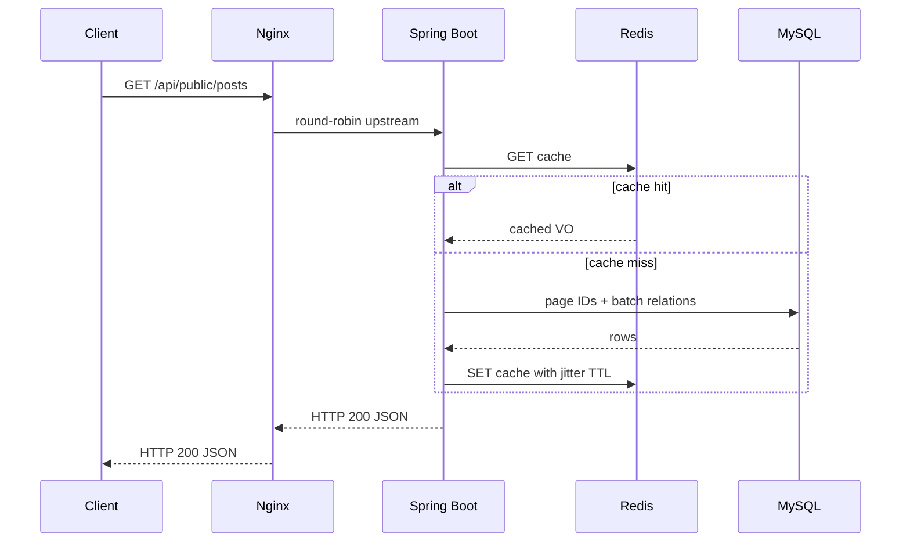
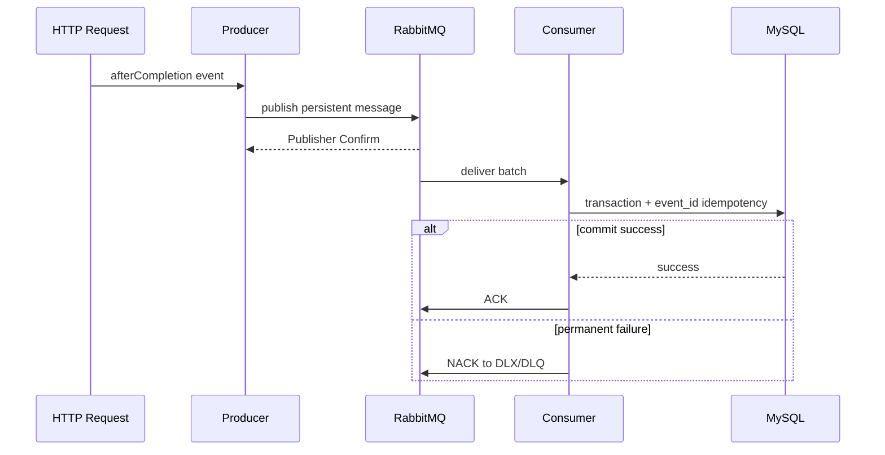
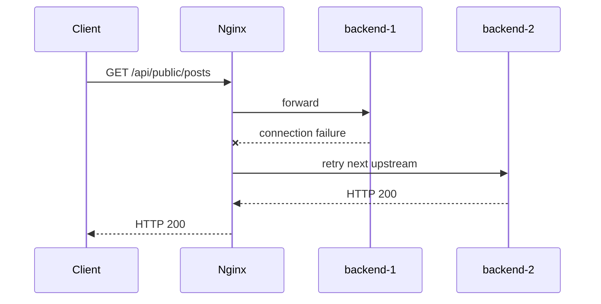

# Aston's Blog 系统架构

> 最后更新：2026-11-10
> 定位：面向高读低写内容平台的模块化单体，不是微服务 Demo

---

## 1. 架构目标

项目优先解决以下问题：

1. 读多写少场景下的查询效率和缓存一致性；
2. 外部依赖故障时核心页面仍可服务；
3. 访问日志写入不阻塞业务请求；
4. 同一应用制品可复制为多个无状态实例；
5. 所有关键取舍都有压测、指标或故障演练支撑。

明确不做：

- 不为了简历硬拆微服务；
- 不引入 Nacos、Sentinel、Kubernetes 全家桶；
- 不把点赞、评论、缓存失效等链路全部塞进 MQ；
- 不宣称没有数据支撑的 QPS 或“高并发”能力。

---

## 2. 系统上下文

```text
Browser
  |
  v
Next.js 15 Frontend :3000
  |
  | HTTP API
  v
Nginx / direct API :8080 / :8088
  |
  v
Spring Boot 4 Modular Monolith :8080
  |-- Controller
  |-- Service
  |-- Repository / JPA
  |-- Security / JWT / RBAC
  |-- Scheduled Tasks
  |-- Actuator / Micrometer
  |
  +--> MySQL 8
  +--> Redis 7
  +--> RabbitMQ
  +--> MinIO（可选共享文件）
  +--> Prometheus / Grafana
```

开发时可直接访问 `8080`。双实例演练时：

```text
Client / k6
  |
  v
Nginx :8088
  |-- Spring Boot :8081
  `-- Spring Boot :8082
          |-- shared MySQL
          |-- shared Redis
          `-- shared RabbitMQ
```

---

## 3. 后端模块职责

| 模块 | 职责 |
|---|---|
| `Controller/` | REST 接口、参数校验、权限入口 |
| `Service/`、`Service/impl/` | 业务逻辑、事务边界、缓存和降级 |
| `repository/` | JPA 查询、分页、批量加载、原子计数 |
| `entity/` | MySQL 表映射 |
| `dto/`、`vo/` | 请求与响应模型 |
| `config/` | Security、Redis、RabbitMQ、Actuator、请求 ID、存储 |
| `task/` | 浏览量刷库、访问日志聚合、缓存预热、点赞校准 |
| `messaging/` | RabbitMQ 生产者、消费者和事件 |
| `storage/` | Local / MinIO 文件存储抽象 |

---

## 4. 核心读路径

### 4.1 文章列表

```text
GET /api/public/posts
  -> Spring Cache
     | hit -> Redis -> response
     ` miss -> service -> MySQL
          -> 两段式分页：先查文章 ID，再批量加载作者/标签
          -> JSON / VO
          -> 写 Redis（TTL + 随机抖动）
```

设计目的：

- 避免 `JOIN FETCH + Page` 对集合关联做内存分页；
- 避免文章列表 N+1；
- 缓存 Key 包含分页、标签、语言等业务维度；
- 文章变更后按版本号或精确 Key 失效，不依赖粗暴 `allEntries=true`。

### 4.2 搜索

```text
GET /api/public/search
  -> Redis 缓存
  ` miss -> MySQL FULLTEXT（title/content）+ 标签 EXISTS
```

当前选择 MySQL FULLTEXT，而不是 Elasticsearch：

- 当前数据规模和搜索复杂度不需要独立搜索引擎；
- 避免索引同步、集群运维和一致性成本；
- 若后续需要分词、相关性排序和大规模聚合，再评估 ES/OpenSearch。

### 4.3 笔记列表

```text
分页查询 notes
  -> 批量查询当前页 comments
  -> 批量查询评论作者
  -> 批量查询当前用户点赞
  -> 按 noteId 分组
  -> 建评论树
  -> 每篇截取前 3 条根评论
```

查询次数从约 42 次/请求下降到约 4 次/请求。

---

## 5. 缓存与热点写

### 5.1 缓存边界

当前缓存重点覆盖：

- 文章列表；
- 文章详情；
- 标签列表；
- 归档；
- 搜索；
- 站点公开设置；
- 首页统计。

### 5.2 Redis 故障降级

```text
@Cacheable
  -> ResilientCacheManager
     | Redis hit -> return
     | Redis miss -> loader -> MySQL -> attempt write-back
     ` Redis failure -> metrics + loader -> MySQL
```

原则：

- 核心页面缓存读路径允许 Redis 故障回源 MySQL；
- 浏览量、在线人数、限流、登录防护、分布式锁各自定义故障语义；
- 不让统一的“缓存降级”错误覆盖所有 Redis 业务。

### 5.3 热点 Key 回源

```text
cache miss
  -> 单实例分段 ReentrantLock
  -> 尝试 Redis 分布式锁
  -> 二次检查缓存
  -> 执行 loader
  -> 写缓存
  -> 释放锁
```

取舍：

- 单实例内强互斥；
- 跨实例抢锁失败采用可用性优先，允许少量重复回源；
- 如果未来要求严格全局只回源一次，需要加入等待、二次检查和超时降级。

### 5.4 浏览量

```text
请求浏览
  -> Redis 增量
  -> 定时任务按 batchId 认领
  -> MySQL INSERT batchId 唯一记录
  -> 文章 view_count 原子 UPDATE
  -> 扣减 Redis 增量
```

Redis 故障期间允许少计，优先保证页面可读。幂等依赖稳定 `batchId` 和数据库唯一键，而不是执行顺序。

---

## 6. RabbitMQ 异步链路

只选择一条链路：访问日志异步写入。

```text
HTTP afterCompletion
  -> VisitLogEventProducer
  -> direct exchange: blog.events
  -> routing key: visit.recorded
  -> durable queue: visit.log.write
  -> consumer manual ACK
  -> MySQL visit_logs
```

可靠性设计：

- 生产者 Publisher Confirm：Broker 已接收；
- 消费端手动 ACK：MySQL 事务提交后才确认；
- `event_id` 唯一键保证至少一次投递下的幂等；
- 批量消费，一批消息使用整体事务；
- 失败批次二分拆批，最终坏消息进入 `visit.log.write.dlq`；
- RabbitMQ 故障时生产端 fail-open，业务请求不因访问日志失败而失败；
- fail-open 的代价是故障期间日志可能丢失，零丢失需要 Outbox。

---

## 7. 多实例与状态外置

双实例要求：

- JWT 无状态，不使用 Sticky Session；
- MySQL、Redis、RabbitMQ 共享；
- 文件存储在 MinIO 模式下共享；
- 定时任务使用 Redis 分布式锁；
- 每个实例只通过端口和环境变量区分；
- 健康检查和优雅停机必须可用。

当前已验证：

- 真实 Nginx 反向代理；
- 单实例宕机自动切换；
- 双实例 RabbitMQ 消费者；
- CPU 资源隔离下单/双实例性能边界；
- 本地文件模式仍只适合单机；MinIO 真实共享验收延期。

---

## 8. 可观测性

| 维度 | 指标 |
|---|---|
| HTTP | 请求量、P50/P95/P99、错误率 |
| JVM | 堆、GC、线程数 |
| Hikari | active、idle、pending、acquire、timeout |
| Redis | 命令耗时、缓存命中/未命中、fallback |
| MySQL | 慢查询计数、连接与 QPS |
| RabbitMQ | messages/ready、unacked、consumers、DLQ、publish failure |
| 定时任务 | 执行次数、耗时、失败、锁竞争 |
| 日志 | `traceId` / `X-Request-Id` 关联 |

Actuator 暴露：

```text
health,info,prometheus,metrics
```

---

## 9. 故障边界

| 故障 | 当前行为 | 代价 / 风险 |
|---|---|---|
| Redis 缓存不可用 | 核心缓存回源 MySQL | 数据库压力上升 |
| Redis 在线人数不可用 | 返回 0 | 统计近似 |
| Redis 留言限流不可用 | fail-open | 短期限流失效 |
| Redis 登录防护不可用 | fail-open | 防爆破能力下降 |
| RabbitMQ 不可用 | 业务 fail-open | 访问日志可能丢失 |
| 单 backend 宕机 | Nginx 切换 | 容量下降，无状态请求可继续 |
| MySQL 不可用 | 核心业务失败 | 当前单点，未做多主/读写分离 |
| MinIO 不可用 | 文件上传/读取失败 | 共享存储验收延期 |

---

## 10. 已知限制

1. 当前是模块化单体，不是微服务；
2. MySQL 仍是主要单点；
3. RabbitMQ 生产端没有 Outbox；
4. 多实例严格全局热点回源未实现；
5. 真实 MinIO 共享文件尚未完成；本轮已用 S3 兼容测试服务验证 `MinioFileStorage` 协议路径；
6. 双实例 Prometheus/Grafana 实例级面板未完成；
7. 真实多机水平扩容需要独立压测机和两台应用节点，当前只在单机资源隔离下验证；
8. Testcontainers 需要 Docker/CI 环境才能完整执行。

---

## 11. 关键时序图

### 11.1 文章列表读请求



### 11.2 RabbitMQ 访问日志链路



### 11.3 单实例故障切换



---

## 12. 相关文档

- `docs/ADR.md`
- `docs/BENCHMARK_RESULT.md`
- `docs/RUNBOOK.md`
- `docs/FAILOVER_DRILL.md`
- `docs/BENCHMARK_PHASE4_SCALING.md`
- `docs/CACHE_AND_HOT_WRITE_REPORT.md`
- `docs/RABBITMQ_VISIT_LOG.md`
